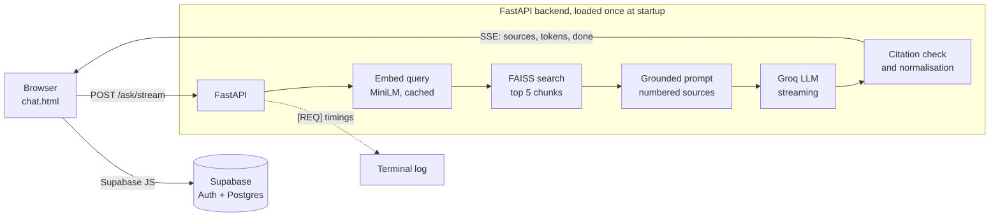

# LawTalk

**A legal research assistant for Indian law that answers from the statutes themselves and cites every passage it relies on.**

LawTalk is a retrieval-augmented generation (RAG) application. You ask a question in plain language. It
retrieves the most relevant passages from an indexed corpus of Indian legal documents, and an LLM writes an
answer that is grounded only in those passages, with inline citations. The answer streams into a research
workspace, and an evidence panel shows the exact retrieved text, so every claim can be checked against
its source. When the documents don't cover a question, LawTalk says so instead of guessing.

## Screenshots


*Landing page: hero with the Lady Justice illustration, features and how it works.*


*Frosted-glass auth modal with a segmented Sign in / Sign up toggle and inline validation.*


*Research workspace: conversation history, streamed answer and composer.*


*Clicking a citation opens the matching retrieved passage in the evidence panel.*


*Light and dark themes, switched with a circular reveal transition.*


*Per-request latency lines and the rolling summary block in the uvicorn terminal.*


*Output of `eval/run_eval.py`: RAGAS, retrieval, citation and latency metrics.*

## Features

- **Cited, grounded answers.** Every legal statement carries an inline citation like `[1]`. Invalid citation numbers are stripped server-side.
- **Evidence panel.** Shows the retrieved passages beside the answer, with document title and page number only when they exist in the index metadata.
- **Honest abstention.** The prompt forbids inventing sections, penalties or cases. Out-of-scope questions get a plain "the sources don't cover this".
- **Streaming responses** over Server-Sent Events, with a stop button, retry and copy actions.
- **Accounts and history** via Supabase Auth and Postgres: searchable conversation list, saved answers and (optionally) saved sources. The API verifies each request's Supabase session server-side.
- **Terminal-only observability.** A per-request latency breakdown and a rolling p50/p95 summary in the server log. Nothing is shown in the UI.
- **Evaluation suite.** RAGAS metrics, Retrieval Recall@5, an LLM-judged citation check and a latency/error benchmark, with before/after comparison.
- **Polished, accessible UI.** Three-pane workspace in a restrained Verdigris × Signal Coral palette, light/dark themes with a circular reveal, subtle GSAP motion, keyboard navigation, focus management, `prefers-reduced-motion` support and sanitized Markdown rendering.

**Indexed documents:** Constitution of India, Indian Penal Code, Code of Criminal Procedure, Indian Evidence Act,
Information Technology Act, Motor Vehicles Act, Consumer Protection Act 2019, POCSO Act, and ICSI labour-law study
material. The IPC, CrPC and Evidence Act were replaced by the BNS, BNSS and BSA on 1 July 2024, and answers based on them say so.

## Tech stack

| Layer | Technology |
|---|---|
| Backend | Python, FastAPI, Uvicorn (async endpoints, SSE streaming) |
| Retrieval | FAISS (flat index), `sentence-transformers/all-MiniLM-L6-v2` embeddings, LangChain loaders/splitters |
| Generation | Groq API, `openai/gpt-oss-120b` (configurable) |
| Auth and data | Supabase Auth and Postgres (`chats`, `messages`), row-level security; bearer-token check on the API |
| Frontend | HTML, Tailwind CSS (CDN), vanilla JavaScript ES modules, GSAP, `marked` and `DOMPurify`; Geist + Playfair Display |
| Evaluation | RAGAS 0.4, Groq-hosted judge model (`qwen/qwen3.8-27b`), httpx benchmark |

## Architecture



**Request pipeline**

1. **Embed:** the question is normalised and embedded with MiniLM. Embeddings and search results are cached (LRU), so repeated questions skip both steps.
2. **Retrieve:** FAISS returns the top 5 chunks with their document, page and chunk ID.
3. **Generate:** a short grounded prompt sends the numbered sources and the question to Groq, which streams the answer token by token.
4. **Stream:** the client receives `sources` first (the evidence panel fills immediately), then `token` events, then `done` with the validated answer and citation list. Closing the connection (Stop) cancels the upstream generation.

The embedding model, FAISS index and Groq client are created once per worker at startup. LLM calls have a timeout,
bounded retries that honour `retry-after`, and a concurrency limit. Provider errors map to clean `503`/`504`/`502`
responses instead of crashes.

## Project structure

```
backend/
  app/
    api/chat.py            /ask and /ask/stream, prompt, citation validation
    core/config.py         settings from environment
    core/metrics.py        per-request timing lines, rolling summary, eval banner
    services/rag.py        index loading, cached embedding + retrieval
    services/groq_client.py  async Groq client, streaming, error mapping
    services/embedder.py   builds the FAISS index from data/legal_docs
  requirements.txt
frontend/
  index.html  chat.html    landing page and research workspace
  css/app.css              design system (tokens, both themes, components)
  css/landing.css          landing page layout
  js/                      chat, api (SSE client), markdown (sanitised), theme, auth
eval/
  testset.json             25 labelled questions (generated by build_testset.py)
  run_eval.py  benchmark.py  results.json  results.md  baseline.json
```

## Setup and running

**Prerequisites:** Python 3.10+, a [Groq API key](https://console.groq.com/), and a Supabase project with `chats` and `messages` tables.

```bash
python -m venv venv
venv\Scripts\activate            # Windows  (macOS/Linux: source venv/bin/activate)
pip install -r backend/requirements.txt
```

Create `backend/.env`:

| Variable | Required | Default | Purpose |
|---|---|---|---|
| `GROQ_API_KEY` | yes | | Groq API key |
| `SUPABASE_URL` | yes | | your Supabase project URL (used to verify sessions) |
| `SUPABASE_KEY` | yes | | the project's public **anon** key (the same one the frontend uses) |
| `GROQ_MODEL` | no | `openai/gpt-oss-120b` | answer model |
| `GROQ_REASONING_EFFORT` | no | `low` | reasoning effort for gpt-oss models (lower time to first token) |
| `GROQ_MAX_TOKENS` | no | `1024` | answer length cap |
| `GROQ_TIMEOUT_S` / `GROQ_MAX_RETRIES` | no | `30` / `2` | upstream timeout and retries |
| `LLM_MAX_CONCURRENCY` | no | `8` | concurrent LLM calls per worker |
| `RETRIEVAL_TOP_K` | no | `5` | chunks per answer |
| `METRICS_SUMMARY_EVERY` | no | `20` | print a metrics summary every N requests |

Build the index once, if `backend/faiss_index/` is missing. Put the PDFs and text files in `backend/data/legal_docs/`, then:

```bash
cd backend
python -m app.services.embedder
```

Start the backend and serve the frontend:

```bash
cd backend
uvicorn app.main:app --port 8000

# in another terminal
cd frontend
python -m http.server 5500       # open http://127.0.0.1:5500
```

The Supabase project URL and the public anon key are configured in `frontend/js/supabase.js`. Data access is
protected by Supabase row-level security, so keep RLS policies enabled on `chats` and `messages`. To keep each
answer's sources with the saved conversation, add a column once:

```sql
alter table public.messages add column if not exists sources jsonb;
```

**API**

All endpoints except `/health` require `Authorization: Bearer <Supabase access token>`; the frontend sends it automatically.

- `POST /ask` with `{"query": "..."}` returns `{answer, mode, sources, citations}`.
- `POST /ask/stream` with the same body returns an SSE stream of `sources`, `token`, then `done` (or `error`).
- `GET /auth/check` verifies a token without calling the LLM.

## Performance and evaluation

All numbers below come from `eval/run_eval.py` against the running backend. "Before" is the original code (commit
`c520c93`) measured with the same benchmark client and questions.

<!-- EVAL:START -->
_Last run: 2026-10-19 14:05:51 — generated by `eval/run_eval.py` from `eval/results.json`._

> **Note:** This run hit provider rate/daily limits: 3 answer requests failed, 28 RAGAS metric calls and 18 citation checks could not be judged, and 12 benchmark requests returned errors. Scores cover only what was measured; re-run with fresh quota for complete numbers.

| Metric | Result | Measured on |
|---|---|---|
| Faithfulness | 0.594 | RAGAS, scored 13/20 answers |
| Answer relevancy | 0.532 | RAGAS, scored 13/20 answers |
| Context precision | 0.268 | RAGAS, scored 13/20 answers |
| Context recall | 0.346 | RAGAS, scored 13/20 answers |
| Retrieval Recall@5 | 0.317 | labelled chunk IDs, n=20 |
| Citation correctness | 0.500 | LLM judge, 2 citations in 10 answers |
| p95 latency (s) | 10.793 | 50 requests |
| Request error rate | 0.240 | errors: {'http_503': 12} |
| Retrieval Hit@5 | 0.450 | >=1 labelled chunk in top 5 |
| Unanswerable declined | 1.000 | keyword heuristic, 2/5 answered |
| TTFT p50 (s) | 0.544 | /ask/stream, n=22 |

**Latency before / after** (same 50-request benchmark: 30 sequential + 20 concurrent, `/ask`)

| | Before (original code) | After | Change |
|---|---|---|---|
| p50 latency (s) | 2.863 | 4.521 | +58% |
| p95 latency (s) | 11.731 | 10.793 | -8% |
| mean latency (s) | 4.512 | 4.440 | -2% |
| error rate | 0.200 | 0.240 | +20% |
<!-- EVAL:END -->

**How to read these numbers**

- The test set is small (25 questions: 20 answerable, 5 out of scope). Reference answers and relevance labels were drafted by an AI assistant from the indexed text and have not been reviewed by a lawyer.
- RAGAS and citation scores are LLM-judged (judge: `qwen/qwen3.8-27b`) and vary between runs.
- Latency is dominated by the Groq free tier's 8,000 tokens/minute limit. Under concurrency, requests queue or are rejected with a clean `503`, which drives the p95 and the error rate.

### Running the evaluation

With the backend running on port 8000, and a token for an existing LawTalk account (auth stays on):

```bash
export EVAL_EMAIL=you@example.com EVAL_PASSWORD=...
export EVAL_AUTH_TOKEN=$(python eval/get_token.py)   # Windows: run it, then `set EVAL_AUTH_TOKEN=<token>`
pip install -r eval/requirements.txt
python eval/run_eval.py                    # full run (~25 min on the free tier)
python eval/run_eval.py --limit 3          # quick smoke test
python eval/run_eval.py --benchmark-only   # re-measure latency only
```

Results are printed as a table and saved to `eval/results.json` and `eval/results.md`, and the block above is
refreshed. See [`eval/README.md`](eval/README.md) for metric definitions, the test-set format and the baseline procedure.

## Known limitations

- Retrieval uses the original 500-character chunks and MiniLM embeddings. Retrieval Recall@5 is modest, and grounded answers then correctly decline more often than they should. Reranking and re-chunking are the next steps (see `eval/README.md` for what was measured).
- Some indexed texts are dated, e.g. the Motor Vehicles Act PDF predates the 2019 amendment, and the labour-law material is from 2014.
- LawTalk provides legal information, not legal advice.

## Author

**Siddhesh K** · [GitHub](https://github.com/SiddheshK1704) · [Report an issue](https://github.com/SiddheshK1704/LawTalk-AI_RAG_Chatbot/issues)
