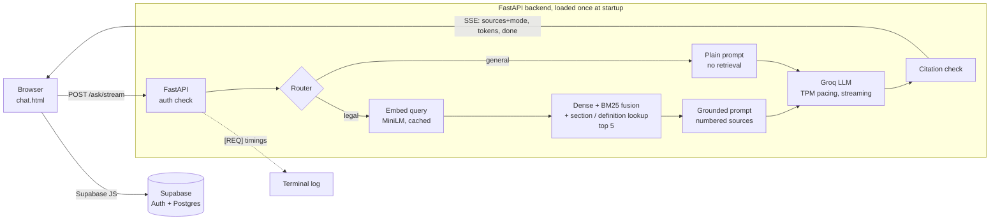

# LAW/TALK

**A legal research assistant for Indian law that answers from the statutes themselves and shows the passage behind every claim.**

LawTalk is a retrieval-augmented generation (RAG) application with two modes. **Legal questions** are answered
from an indexed corpus of Indian legal documents: LawTalk retrieves the relevant passages, an LLM writes an
answer grounded only in them with numbered citations, and the evidence panel shows the exact retrieved text.
**Other questions** go to a normal assistant mode with no document search and no evidence panel, so it is
always clear which answers are grounded in sources. When the documents don't cover a legal question, LawTalk
says so instead of guessing.

## Screenshots


*Landing page: editorial hero with the Lady Justice artwork, product preview, how it works and features.*


*The Justice Orb: sign-in travels from the navbar into a circle that flips to reveal sign-up.*


*Research workspace: conversation history, streamed answer and composer.*


*Clicking a citation opens the matching retrieved passage, with its Act, section and page.*


*Light and dark themes, switched with a circular reveal transition.*


*Per-request latency lines and the rolling summary block in the uvicorn terminal.*


*Output of `eval/run_eval.py`: RAGAS, retrieval, citation and latency metrics.*

## Features

- **Two chat modes.** A router sends legal questions to RAG and everything else to a normal LLM answer, using legal vocabulary plus similarity to the indexed corpus, so legal questions without obvious keywords, such as "What is a dying declaration?", still use the sources.
- **Hybrid retrieval.** FAISS dense search (MiniLM) fused with BM25 lexical search, plus exact lookup of named provisions ("Article 21", "Section 438 CrPC") and statutory definitions ("who is a child under POCSO").
- **Cited, grounded answers.** Every legal statement ends with a citation like `[1]`; citations to non-existent sources are removed server-side, and source notes (e.g. "replaced by the BNS from 1 July 2024") come from the index, not the model.
- **Evidence panel.** Opens only for legal answers and only ever shows the passages retrieved for that answer, with document, section and page when the source records them.
- **Streaming** over Server-Sent Events, with stop, retry and copy.
- **Accounts and history** via Supabase Auth and Postgres; the API verifies each request's Supabase session.
- **Reliability.** Client-side tokens-per-minute pacing for the Groq free tier, bounded retries, clean 503/504 errors, and terminal metrics that separate provider rate limits from application errors.
- **Evaluation and tests.** RAGAS, Recall@5/Hit@5/MRR, an LLM citation judge and a latency benchmark; 37 automated tests (19 backend, 18 browser).
- **Editorial interface.** A Concrete × Cobalt palette, Instrument Serif with Geist, light/dark themes, restrained GSAP motion, keyboard-accessible throughout, with `prefers-reduced-motion` support.

**Indexed documents:** Constitution of India, Indian Penal Code, Code of Criminal Procedure, Indian Evidence Act,
Information Technology Act, Motor Vehicles Act, Consumer Protection Act 2019, POCSO Act, and ICSI labour-law study
material. The IPC, CrPC and Evidence Act were replaced by the BNS, BNSS and BSA on 1 July 2024; their passages carry that note.

## Tech stack

| Layer | Technology |
|---|---|
| Backend | Python, FastAPI, Uvicorn (async endpoints, SSE streaming) |
| Retrieval | FAISS (flat inner-product index), `sentence-transformers/all-MiniLM-L6-v2`, BM25 (SciPy), LangChain loaders/splitters |
| Generation | Groq API, `openai/gpt-oss-120b` (configurable) |
| Auth and data | Supabase Auth and Postgres (`chats`, `messages`), row-level security; bearer-token check on the API |
| Frontend | HTML, Tailwind CSS (CDN), vanilla JavaScript ES modules, GSAP, `marked` + `DOMPurify`; Instrument Serif, Geist, Geist Mono |
| Evaluation | RAGAS 0.4 with Groq-hosted judges (`qwen/qwen3.8-27b`, `openai/gpt-oss-20b`), httpx benchmark |
| Tests | pytest, Playwright (Chromium) |

## Architecture



**Request pipeline**

1. **Route:** small talk and non-legal questions go to normal mode; questions with legal terms, or that closely match the corpus, go to RAG.
2. **Retrieve (RAG):** the question, with common terms mapped to statutory wording (e.g. "anticipatory bail" → "bail to person apprehending arrest"), is searched densely and lexically; results are fused, and named provisions or definitions are pinned first.
3. **Generate:** Groq streams an answer from the numbered sources only; requests are paced to stay under the provider's tokens-per-minute limit.
4. **Stream:** the client receives `sources` with the mode first (the evidence panel opens only for `RAG`), then tokens, then `done` with the validated answer and citations.

## Project structure

```
backend/
  app/
    api/chat.py             /ask, /ask/stream, /auth/check; prompts, routing, citation validation
    core/                   config, auth (Supabase session check), metrics (terminal)
    services/router.py      legal (RAG) vs general (LLM) mode
    services/ingest.py      PDF extraction (cached), cleaning, section-aware chunking, index build
    services/rag.py         dense + BM25 retrieval, section and definition lookup, caches
    services/groq_client.py async Groq client, TPM pacing, streaming, error mapping
frontend/
  index.html  chat.html     landing page and research workspace
  css/app.css               design system (tokens for both themes, components)
  css/landing.css           landing page and Justice Orb
  js/                       chat, api (SSE client), markdown (sanitised), theme, auth, ui (landing)
eval/                       test set, run_eval.py, benchmark.py, retrieval_experiments.py, results
tests/                      pytest backend tests; tests/e2e Playwright browser tests
```

## Setup and running

**Prerequisites:** Python 3.10+, a [Groq API key](https://console.groq.com/), and a Supabase project with `chats` and `messages` tables.

```bash
python -m venv venv
venv\Scripts\activate            # Windows  (macOS/Linux: source venv/bin/activate)
pip install -r backend/requirements.txt
```

Create `backend/.env`:

| Variable | Required | Default | Purpose |
|---|---|---|---|
| `GROQ_API_KEY` | yes | | Groq API key |
| `SUPABASE_URL` | yes | | your Supabase project URL (used to verify sessions) |
| `SUPABASE_KEY` | yes | | the project's public **anon** key (the same one the frontend uses) |
| `GROQ_MODEL` | no | `openai/gpt-oss-120b` | answer model |
| `GROQ_REASONING_EFFORT` | no | `low` | reasoning effort for gpt-oss models |
| `GROQ_MAX_TOKENS` | no | `1024` | answer length cap |
| `GROQ_TPM_BUDGET` / `GROQ_MAX_QUEUE_S` | no | `7000` / `20` | tokens-per-minute pacing, and the longest a request waits before a clean "busy" error |
| `GROQ_TIMEOUT_S` / `GROQ_MAX_RETRIES` | no | `30` / `2` | upstream timeout and retries |
| `RETRIEVAL_TOP_K` | no | `5` | passages per answer |
| `RETRIEVAL_HYBRID` / `RETRIEVAL_SECTION_LOOKUP` / `RETRIEVAL_RERANK` | no | `1` / `1` / `0` | retrieval stages (for experiments) |
| `METRICS_SUMMARY_EVERY` | no | `20` | print a metrics summary every N requests |

Build the index once (writes `backend/faiss_index_v2/`; page text is cached, so rebuilds take ~3 minutes).
Put the PDFs and text files in `backend/data/legal_docs/`, then:

```bash
cd backend
python -m app.services.ingest
```

Start the backend and serve the frontend:

```bash
cd backend
uvicorn app.main:app --port 8000

# in another terminal
cd frontend
python -m http.server 5500       # open http://127.0.0.1:5500
```

The Supabase project URL and public anon key are configured in `frontend/js/supabase.js`; keep row-level security
enabled on `chats` and `messages`. To keep each answer's sources with the saved conversation, add a column once:

```sql
alter table public.messages add column if not exists sources jsonb;
```

**API** (all endpoints except `/health` require `Authorization: Bearer <Supabase access token>`)

- `POST /ask` with `{"query": "..."}` returns `{answer, mode: "RAG" | "LLM", sources, citations}`.
- `POST /ask/stream` returns SSE: `sources` `{mode, sources}`, then `token` events, then `done` (or `error`).
- `GET /auth/check` verifies a token without calling the LLM.

### Tests

```bash
pip install -r requirements-dev.txt
python -m playwright install chromium
python -m pytest tests                   # 19 backend + 18 browser tests; no network or credentials needed
```

## Performance and evaluation

### Retrieval (measured, same 20 labelled questions before and after)

From `python eval/retrieval_experiments.py` (no LLM calls; labels resolved by the same rule for every index).

| Variant | Recall@5 | Hit@5 | MRR | Retrieval p50 |
|---|---:|---:|---:|---:|
| Original index (500-char chunks per page), dense — *baseline* | 0.317 | 0.450 | 0.310 | ~10 ms |
| New chunking (section-aware, no TOC pages, word repair) | 0.493 | 0.550 | 0.485 | ~10 ms |
| + context header on each chunk | 0.560 | 0.700 | 0.567 | ~10 ms |
| + BM25 fusion, statutory-wording glossary | 0.610 | 0.750 | 0.534 | ~11 ms |
| **+ section and definition lookup (shipped)** | **0.710** | **0.850** | **0.634** | ~11 ms |
| + cross-encoder rerank (not shipped: worse and ~65× slower) | 0.677 | 0.800 | 0.652 | ~640 ms |

The glossary and definition lookup were added after inspecting failures on this test set, so these scores are
somewhat optimistic; a held-out question set is the next step.

### Answer quality and latency

<!-- EVAL:START -->
_Last run: 2026-10-19 14:05:51 — generated by `eval/run_eval.py` from `eval/results.json`._

> **Note:** This run measured the **previous version** (before the retrieval, routing and pacing changes above). It also hit provider rate/daily limits: 3 answer requests failed, 28 RAGAS metric calls and 18 citation checks could not be judged, and 12 benchmark requests returned errors.

| Metric | Result | Measured on |
|---|---|---|
| Faithfulness | 0.594 | RAGAS, scored 13/20 answers |
| Answer relevancy | 0.532 | RAGAS, scored 13/20 answers |
| Context precision | 0.268 | RAGAS, scored 13/20 answers |
| Context recall | 0.346 | RAGAS, scored 13/20 answers |
| Retrieval Recall@5 | 0.317 | labelled chunk IDs, n=20 |
| Citation correctness | 0.500 | LLM judge, 2 citations in 10 answers |
| p95 latency (s) | 10.793 | 50 requests |
| Request error rate | 0.240 | errors: {'http_503': 12} |
| TTFT p50 (s) | 0.544 | /ask/stream, n=22 |
<!-- EVAL:END -->

**Not yet measured for the current version:** RAGAS scores, citation correctness and the 50-request latency
benchmark. The re-run on 2026-10-19 stopped when the Groq free tier's daily token cap (200K tokens/day per model)
was reached. In that partial run, 27 of 30 sequential requests completed: 21 in 0.41–3.23 s and 6 after
waiting 46.7–54.2 s for tokens-per-minute budget (that wait is now capped at 20 s by `GROQ_MAX_QUEUE_S`); the
other 3 hit the daily cap. Re-run with fresh quota to fill this section.

**How to read these numbers:** the test set is small (25 questions: 20 answerable, 5 out of scope), and the
reference answers and labels were drafted by an AI assistant from the indexed text without review by a lawyer.
RAGAS and citation scores are LLM-judged and vary between runs. Latency under load is bounded by the provider's
8,000 tokens/minute: requests now queue briefly or get a clean "busy" error instead of failing as HTTP 500.

### Running the evaluation

With the backend running and a token for an existing LawTalk account (auth stays on):

```bash
pip install -r eval/requirements.txt
export EVAL_EMAIL=you@example.com EVAL_PASSWORD=...
export EVAL_AUTH_TOKEN=$(python eval/get_token.py)   # Windows: run it, then `set EVAL_AUTH_TOKEN=<token>`
python eval/run_eval.py                    # full run (~30 min on the free tier)
python eval/run_eval.py --in-process       # same pipeline without HTTP/auth, if no token is available
python eval/retrieval_experiments.py       # retrieval only, no API cost
```

Results are saved to `eval/results.json` and `eval/results.md`, and the block above is refreshed.
See [`eval/README.md`](eval/README.md) for metric definitions and the test-set format.

## Known limitations

- Retrieval misses remain on 3 of 20 test questions (Hit@5 0.85); targets of ≥0.90 Hit@5 and ≥0.85 Recall@5 are not yet met.
- The Groq free tier (8K tokens/minute, 200K/day per model) limits throughput to about 4 legal answers per minute and caps how much evaluation can run per day.
- Some indexed texts are dated (the Motor Vehicles Act PDF predates the 2019 amendment; the labour-law material is from 2014).
- Section labels are detected from the document text and shown only where detection succeeded.
- LawTalk provides legal information, not legal advice.

## Author

**Siddhesh K** · [GitHub](https://github.com/SiddheshK1704) · [Report an issue](https://github.com/SiddheshK1704/LawTalk-AI_RAG_Chatbot/issues)
